<div align="center">
  
</div>

<table align="center">
  <tr>
    <td align="center"><code>▛▀▀▀▀▀▀▀▀▀▀▀▀▀▀▀▀▀▀▀▀▀▀▀▀▀▀▀▀▜</code></td>
  </tr>
  <tr>
    <td align="center"><b><code>F L A V I O&nbsp;&nbsp;J A C O P U C C I</code></b></td>
  </tr>
  <tr>
    <td align="center"><code>▙▄▄▄▄▄▄▄▄▄▄▄▄▄▄▄▄▄▄▄▄▄▄▄▄▄▄▄▄▟</code></td>
  </tr>
</table>

<p align="center">
  
</p>

<p align="center">
  
  
  
  
  
  
</p>

<p align="center">
  <sub><code>FJ</code> · Ing. Informatica <b>110L</b> · Italia · aperto a opportunità · <code>@NotJenova</code></sub>
</p>

---

## ▸ about

<table>
  <tr>
    <td width="220" align="center" valign="top">
      
      <br>
      <sub><code>FJ</code> · avatar GitHub</sub>
    </td>
    <td valign="top">
      <sub><b>Flavio Jacopucci</b> · Ingegnere Informatico &amp; Full-Stack Developer</sub>
      <br><br>
      <i>Ingegneria Informatica incontra il Modern Full-Stack.</i>
      <br><br>
      <sub>Due gambe, stesso passo: le <b>basi</b> — algoritmi, strutture dati, reti, architetture software — e il <b>modern web</b> con Next.js, TypeScript e Tailwind. Chiudo il cerchio dove il codice incontra la macchina: deployment e containerizzazione su cloud.</sub>
      <br><br>
      <sub>🔧 <b>currently learning</b> · system design e architetture distribuite · testing end-to-end · performance dei Core Web Vitals</sub>
      <br><br>
      <sub>📍 Italia · 🌍 remoto-friendly · ✉️ <a href="mailto:flavio.jacopucci@gmail.com">flavio.jacopucci@gmail.com</a></sub>

```bash
$ whoami
flavio_jacopucci  —  FJ  ·  Ingegnere Informatico & Full-Stack Developer

$ uptime
laurea in Ing. Informatica · 110L · build → rompi → refactor → ship

$ stack --sorted
frontend   next.js · react 19 · typescript · tailwind · framer-motion · tanstack query
backend    node.js · express · prisma · postgresql · redis · nextauth / oauth2
infra      aws (ec2 / s3 / ecs) · docker · kubernetes · github actions · terraform · vercel
cs-core    c/c++ · python · strutture dati · graph theory · dynamic programming
ml         pytorch · tensorflow · pandas · scikit-learn
mobile     react native · expo

$ learning --now
system design · distributed systems · e2e testing
```

</td>
</tr>
</table>

---

## ▸ stats

> Numeri veri, nessun gonfiaggio: la card legge il profilo dal vivo, quindi si aggiorna a ogni push (oggi: pochi contributi, 1 repo pubblico).

<p align="center">
  
</p>

<!--
  NOTA WIDGET — HTTP 200 non basta, conta anche cosa disegna la card (verificato col corpo della risposta).
  Tenuta: profile-details -> numeri reali (5 contributi, 1 repo pubblico, "Joined GitHub 2 years ago").
  Disattivate perché oggi rendono un empty-state falso:
    - most-commit-language -> "Top Languages by Commit: PHP" (nessun repo PHP)
    - repos-per-language   -> "Top Languages by Repo / There are no repos to show"
  Non sono rotte: si popolano da sole quando i repo pubblici aumentano.
  Per riattivarle basta scommentare il blocco qui sotto.

  <p align="center">
    
    
  </p>

  Altre istanze testate: github-readme-stats "sigma-five" risponde 200 ma il corpo è la card
  "Something went wrong!"; l'istanza ufficiale dà 503 (rate limit) e activity-graph 402 (a pagamento).
  Con un'istanza readme-stats sana (o self-hostata su Vercel + PAT) si possono usare:
    {host-readme-stats}/api?username=NotJenova&show_icons=true&theme=tokyonight&hide_border=true
    {host-readme-stats}/api/top-langs/?username=NotJenova&layout=compact&theme=tokyonight&hide_border=true
-->

---

## ▸ projects

<table>
  <tr>
    <td width="50%" valign="top">
      <code>🟪🟪🟪🟪🟪🟪🟪🟪🟪🟪</code><br>
      <b><code>TaskFlow</code></b><br>
      
      
      
      
      <br>
      <sub>Kanban realtime con RBAC, drag-and-drop e notifiche email. Backend a moduli DDD su PostgreSQL.</sub><br>
      <sub><i>🔒 repo privato / in arrivo</i></sub>
      <!-- TODO: inserire URL repo reale -->
      <br><code>🟪🟪🟪🟪🟪🟪🟪🟪🟪🟪</code>
    </td>
    <td width="50%" valign="top">
      <code>🟦🟦🟦🟦🟦🟦🟦🟦🟦🟦</code><br>
      <b><code>AlgoViz</code></b><br>
      
      
      
      <br>
      <sub>Visualizzatore di algoritmi: pathfinding A* e Dijkstra disegnati su Canvas, calcoli pesanti fuori dal main thread con i Web Workers.</sub><br>
      <sub><i>🔒 repo privato / in arrivo</i></sub>
      <!-- TODO: inserire URL repo reale -->
      <br><code>🟦🟦🟦🟦🟦🟦🟦🟦🟦🟦</code>
    </td>
  </tr>
  <tr>
    <td width="50%" valign="top">
      <code>🟨🟨🟨🟨🟨🟨🟨🟨🟨🟨</code><br>
      <b><code>InfraWatch</code></b><br>
      
      
      
      
      <br>
      <sub>Dashboard di monitoring: metriche in streaming via WebSocket, storage time-series su TimescaleDB, infrastruttura provisionata con Terraform su EC2.</sub><br>
      <sub><i>🔒 repo privato / in arrivo</i></sub>
      <!-- TODO: inserire URL repo reale -->
      <br><code>🟨🟨🟨🟨🟨🟨🟨🟨🟨🟨</code>
    </td>
    <td width="50%" valign="top">
      <code>🟩🟩🟩🟩🟩🟩🟩🟩🟩🟩</code><br>
      <b><code>DevPortfolio</code></b><br>
      
      
      <br>
      <sub>Portfolio su App Router con Tailwind v4 e sidebar animata. Core Web Vitals tenuti d'occhio sul serio, non a parole.</sub><br>
      <sub><i>🔒 repo privato / in arrivo</i></sub>
      <!-- TODO: inserire URL repo reale -->
      <br><code>🟩🟩🟩🟩🟩🟩🟩🟩🟩🟩</code>
    </td>
  </tr>
</table>

---

## ▸ commit garden

<sub>Ogni quadratino è un commit, ogni commit è un pixel. Il giardino cresce solo quando cresce il codice: niente scorciatoie.</sub>

<p align="center">
  
  <br>
  <sub><code>▫</code> nessun commit · <code>🟦</code> giorno attivo · la semina è appena iniziata</sub>
  <br>
  <sub><i>nota:</i> il calendario è disegnato con caselle chiare (<code>#EEEEEE</code>) e label grigie, senza sfondo proprio: si legge bene in light theme, stona su GitHub dark.</sub>
</p>

<p align="center">
  
</p>

<!--
  activity graph (host github-readme-activity-graph) risponde HTTP 402: endpoint a pagamento.
  Il "garden" quindi usa ghchart (calendario contributi reale) + streak stats, entrambi HTTP 200.

  ghchart: colori fissi, nessun parametro theme (celle vuote #EEEEEE, label #767676).
  Per allinearlo al tema scuro, in alternativa:
    - self-hostare ghchart (immagine Docker) e aggiungerci un tema scuro;
    - usare un fork/istanza che accetti ?theme=dark e cambiare solo l'host nell' sopra;
    - tornare a github-readme-activity-graph quando l'endpoint non risponde più 402:
      https://github-readme-activity-graph.vercel.app/graph?username=NotJenova&theme=tokyonight
-->

---

<p align="center">
  
</p>

## ▸ connect

<table>
  <tr>
    <td align="center"><sub>✉️ <b>email</b></sub><br><a href="mailto:flavio.jacopucci@gmail.com"><code>flavio.jacopucci@gmail.com</code></a></td>
    <td align="center"><sub>🐙 <b>github</b></sub><br><a href="https://github.com/NotJenova"><code>@NotJenova</code></a></td>
    <td align="center"><sub>💼 <b>linkedin</b></sub><br><sub><i>in arrivo</i></sub> <!-- TODO: inserire URL LinkedIn reale --></td>
  </tr>
</table>

<p align="center">
  <sub>Fatto a mano, pixel per pixel · 2026</sub>
</p>
